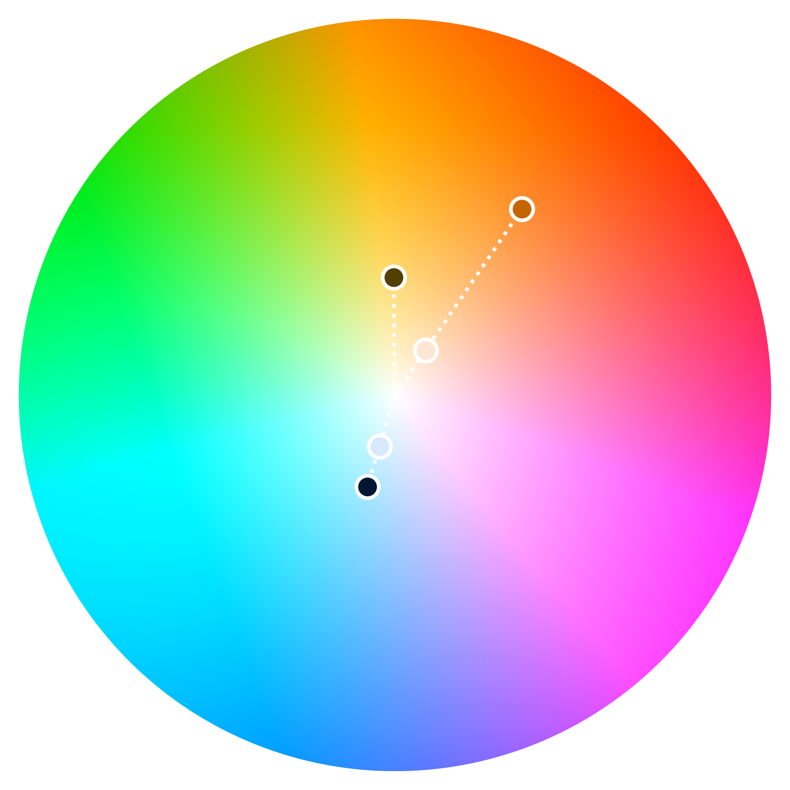
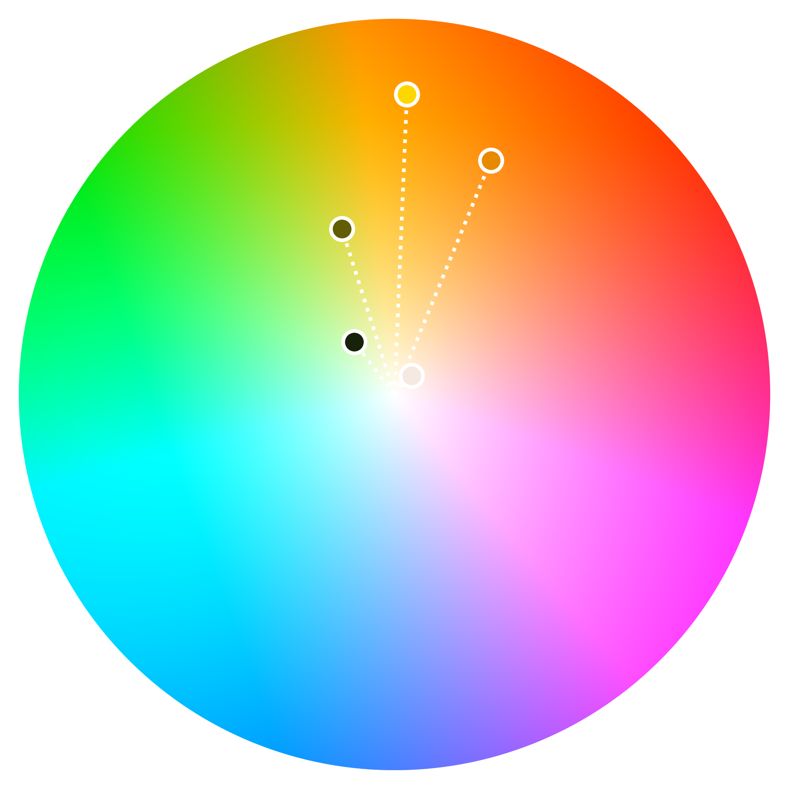
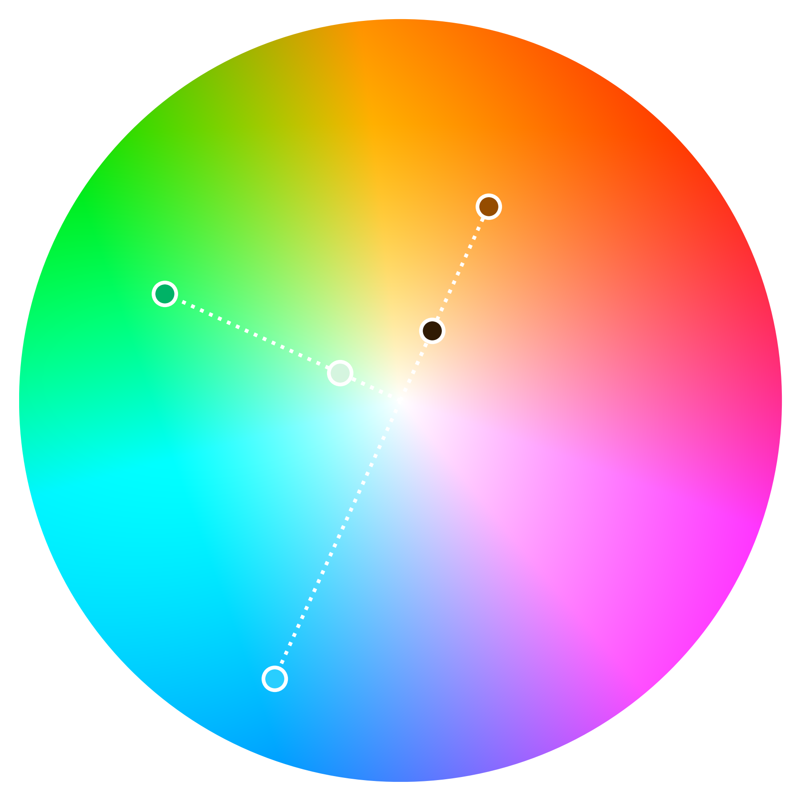
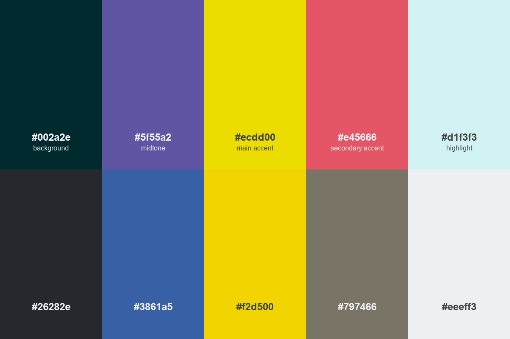
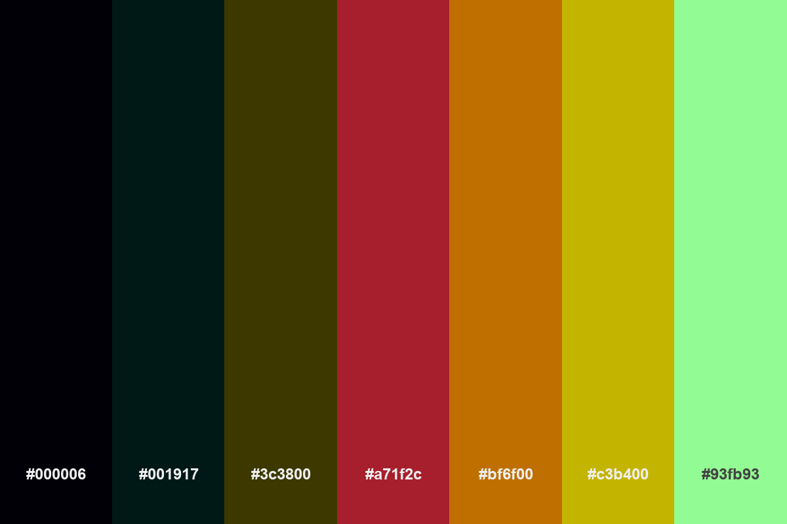
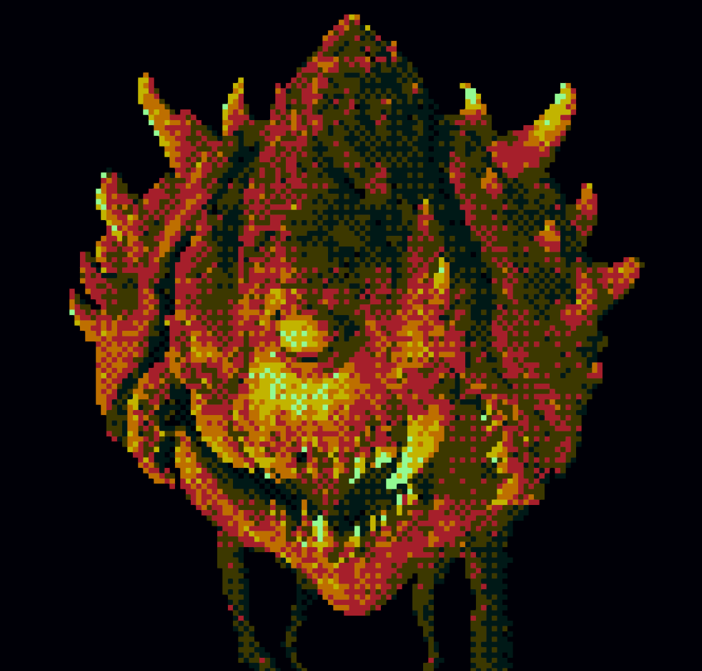

# py-color-mixer
### Python utility to procedurally generate and process usable artistic color palettes.
### No AI, just math.

A collection of color math functions, aimed to procedurally create color palettes on the fly. It is an iteration on a Python script for Substance Designer I wrote for my [procedural graffiti generator](https://www.artstation.com/artwork/DvVJNG) but more flexible with much more usable results.

It is mostly build around the [OKLCH](https://oklch.com) color space to create palettes based on color harmonies but there are conversions to some other color spaces, like [OKLAB](https://bottosson.github.io/posts/oklab/) for interpolating between colors, sRGB to import/export hex codes, etc.

The palettes are built on Numpy and most operations work on whole color palettes.

## usage
To make sure the colors don't compete with one another we can assign explicit roles to them. 
This example creates a 5 color palette based on a split-complement harmony.
```python
TARGET_ROLES = [
  Role.DEEP_BASE,
  Role.MID_SUPPORT,
  Role.HERO_ACCENT,
  Role.SECOND_ACCENT,
  Role.HIGHLIGHT
]

root   = OKLCHPalette.new_random(1,seed=None)  # -> palette of size 1
splits = root.split_complement(bias=30)        # -> palette of size 2

colors = ( 
  OKLCHPalette.merge(root, root, splits, root) # -> palette of size 5
  .apply_roles(TARGET_ROLES)
  .make_srgb_safe()   # prettier than clipping, just in case we went out of gamut along the way
)

hex_codes = colors.to_hex()   # will handle the OKlch-sRGB conversion
```



## Analogous Palette
Applying the roles sets the lightness and chroma accordingly resulting in distinct shades. The sort_for_roles functions sorts colors on how well they perform when toned down. For example preferring dark blue colors over dark yellow ones.
```python
root = OKLCHPalette.new_random(1,seed=None)
colors = (
  root.generate_analogous(5,stepsize=20)
  .sort_for_roles()
  .apply_roles(TARGET_ROLES, seed=None
  .limit_chroma(0.2)
)
```



## Custom Harmonies
The module is kept ... well modular to quickly experiment and create new algorithms. This one for example combines two complementary hues with an orthogonal one:
```python
root = OKLCHPalette.new_random(1,seed=None)
quadrant    = root.shift_hue(90)
complement  = root.complement()

colors = (
  OKLCHPalette.merge(root,root,complement,quadrant,quadrant)
  .apply_roles(TARGET_ROLES,seed=None)
  .limit_chroma(0.2)
)
```



## Color Vision Deficency Emulation
You can quickly check you palettes against the most common types of color vision deficiency.
- Protanopia / Protanomaly(50%)
- Deuteranopia / Deuteranomaly (50%)
- Tritanopia / Tritanomaly (50%)

The full severity transformations are taken straight from colour-science, the 50% severities are estimates.
I would recommend using the [colour-science](https://colour.readthedocs.io/en/develop/) directly, if you need the exact values.

A square harmony palette with and without protanopia emulation:



The original example:


and with protanopia emulation:


## Linear Lightness example

OKLAB and OKLCH are designed to maintain a consistent perceived brightness. This comes in very useful to create colors with gradual brightness.
Example from my [Unity dithering project](https://www.artstation.com/artwork/dyA5g3):





## attributions:
vecteezy.com/free-vector/corporate, 
vecteezy.com/free-vector/leopard, 
vecteezy.com/free-vector/floral, 
freevector.com/geometric-poster-98922
colour.readthedocs.io/en/develop
